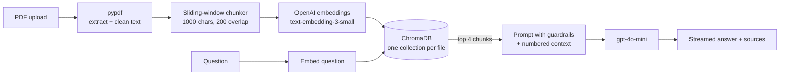

# EduPulse AI

A personalized AI study companion. Upload a PDF textbook or syllabus and EduPulse lets you
**chat with it**, **generate practice quizzes** and **study with flashcards**. Every answer is
grounded in your own document and cites the pages it came from.

Built with Python, OpenAI, ChromaDB and two front ends: a **Streamlit** app and a
**React** app backed by **FastAPI**. Both share the same core package.

## Features

- **Chat with Notes**: retrieval-augmented answers (RAG) with page citations and a
  Sources panel. If the answer isn't in your document, the tutor says *"I don't know."*
  instead of making something up.
- **Quiz Generator**: multiple-choice questions on the whole document or a topic you pick,
  graded instantly with explanations.
- **Flashcards**: term/definition cards you can flip, shuffle and export to Anki or Quizlet (CSV).
- **Semantic search**: find passages by meaning, with similarity scores and highlighted terms.
- **Teaching styles**: choose a persona (Software Engineer, Medical Tutor, Math Coach, ...)
  and a tone (Encouraging, Concise, Socratic, ...).
- **Document library**: indexed PDFs are stored locally, and re-uploading the same file is instant.
- **Prompt Architect**: paste any text and get an explanation, summary or study notes.
- Streaming responses, chat export (JSON/Markdown), bring-your-own API key.

## How it works



1. **Parsing** (`pdf_parser.py`): text is extracted page by page; ligatures, hyphenated line
   breaks, running headers/footers and page numbers are cleaned up.
2. **Chunking** (`chunker.py`): overlapping windows that end on paragraph or sentence
   boundaries and remember their page range.
3. **Indexing** (`vector_store.py`): chunks and their embeddings go into a persistent ChromaDB
   collection (cosine distance) named after the file's SHA-256 hash.
4. **Retrieval + generation** (`rag_engine.py`): the question (plus the previous one for short
   follow-ups like *"why?"*) is embedded and the closest chunks are put into the system prompt
   inside `<context>` tags. The model may only use that context and must cite it as `[1]`, `[2]`.
5. **Study tools** (`study_tools.py`): quizzes and flashcards use OpenAI structured outputs
   (Pydantic models), then get validated in Python. Bad questions are dropped and answer
   positions are shuffled.

## Project structure

```
app.py                  Streamlit front end
api/main.py             FastAPI backend for the React front end
frontend/               React (Vite) front end
edupulse/               shared core package
  config.py             settings and API key lookup (.env, sidebar, Streamlit secrets)
  llm.py                OpenAI chat, streaming, structured outputs, friendly errors
  prompts.py            persona/tone prompts and RAG guardrails
  pdf_parser.py         PDF text extraction and cleaning
  chunker.py            sliding-window chunker
  embeddings.py         batched embeddings with a small query cache
  vector_store.py       ChromaDB wrapper
  ingest.py             parse -> chunk -> embed -> index
  rag_engine.py         retrieval-augmented answers
  study_tools.py        quiz, flashcards and key takeaways
  ui_components.py      Streamlit widgets
data/personas.json      tutor personas and tones
samples/                a small sample PDF to try the app with
scripts/                API check, CLI search demo, sample PDF generator
tests/                  pytest suite (uses fake OpenAI clients, no API calls)
```

## Getting started

Requirements: Python 3.11+ (3.12 recommended), an [OpenAI API key](https://platform.openai.com/api-keys),
and Node 20+ if you want the React front end.

```bash
git clone <your-fork-url> edupulse-ai
cd edupulse-ai
python -m venv .venv
.venv\Scripts\activate          # Windows
# source .venv/bin/activate     # macOS / Linux
pip install -r requirements.txt
cp .env.example .env            # then put your key in OPENAI_API_KEY
python scripts/check_api.py     # optional: check that the key works
```

### Streamlit app

```bash
streamlit run app.py
```

Open http://localhost:8501, upload a PDF (try `samples/cell_biology_notes.pdf`) and start asking.

### React app + API

```bash
pip install -r requirements-api.txt
uvicorn api.main:app --reload --port 8000      # terminal 1

cd frontend
npm install
npm run dev                                    # terminal 2 -> http://localhost:5173
```

The Vite dev server proxies `/api` to port 8000. Both front ends use the same `.chroma/`
folder, so a PDF indexed in one shows up in the other.

### Command line

```bash
python scripts/search_pdf.py samples/cell_biology_notes.pdf "What does the Golgi apparatus do?"
```

## Configuration

| Variable | Default | Purpose |
|---|---|---|
| `OPENAI_API_KEY` | (none) | Required unless users paste their own key in the UI |
| `OPENAI_MODEL` | `gpt-4o-mini` | Chat model |
| `EMBED_MODEL` | `text-embedding-3-small` | Embedding model |
| `OPENAI_TEMPERATURE` | `0.3` | Sampling temperature |
| `CHROMA_DIR` | `.chroma` | Where the vector database is stored |
| `CORS_ORIGINS` | `http://localhost:5173` | Allowed origins for the API (comma separated) |

Changing `EMBED_MODEL` after documents were indexed requires re-indexing them (delete `.chroma/`).

## Tests

```bash
pip install -r requirements-dev.txt
pytest          # ~190 tests, no network or API key needed
ruff check .
cd frontend && npm run build
```

The tests use a fake OpenAI client and a bag-of-words fake embedder, and drive the Streamlit
app with `streamlit.testing.v1.AppTest` (uploads, chat, quiz, flashcards).

## Deployment

### Streamlit Community Cloud (free)

1. Push the repository to GitHub.
2. Go to [share.streamlit.io](https://share.streamlit.io), click **Create app** and pick the
   repo, branch `main` and main file `app.py`.
3. Under **Advanced settings**, choose Python **3.12** and paste your secrets
   (see `.streamlit/secrets.toml.example`):
   ```toml
   OPENAI_API_KEY = "sk-..."
   ```
4. Deploy. Streamlit Cloud installs `requirements.txt` only, so the API/test packages stay out.

Notes:
- If you leave `OPENAI_API_KEY` out of the secrets, visitors have to paste their own key in
  the sidebar. Use this for a public demo so strangers can't spend your credits.
- The app's disk is temporary on Streamlit Cloud, so indexed documents disappear when the app
  restarts or sleeps. Uploading the PDF again rebuilds the index.
- If the logs say *"unsupported version of sqlite3"*, add `pysqlite3-binary` to
  `requirements.txt`; `edupulse/__init__.py` switches to it automatically.

### React + API as one service

After `npm run build`, FastAPI also serves `frontend/dist`, so a single web service is enough
(e.g. Render or Railway):

```bash
# build command
pip install -r requirements-api.txt && cd frontend && npm ci && npm run build
# start command
uvicorn api.main:app --host 0.0.0.0 --port $PORT
```

Set `OPENAI_API_KEY` in the host's environment. To host the front end separately instead,
build it with `VITE_API_BASE=https://your-api.example.com` and add that site's URL to
`CORS_ORIGINS` on the API.

## Built step by step

The project followed a 30-day plan, and each weekly milestone is tagged in git:

| Tag | Milestone |
|---|---|
| `week1-prompt-architect` | Python + Streamlit basics: the Prompt Architect |
| `week2-ai-mentor` | OpenAI API, streaming chat with memory, structured outputs |
| `week3-knowledge-base` | PDF parsing, chunking, embeddings, ChromaDB semantic search |
| `v1.0.0` | Full RAG app with quiz, flashcards, React front end and deployment |

```bash
git checkout week2-ai-mentor   # look at the project as it was after week 2
```
